# 🛒 Marketplace Review Intelligence

> Análise de **202.785 avaliações** de consumidores sobre produtos de beleza e cuidados capilares no Mercado Livre: da base bruta em JSON até um dashboard interativo no Power BI, passando por limpeza, engenharia de atributos e análise de sentimento em português.

### 🚀 Dashboard do projeto => <a href="https://app.powerbi.com/view?r=eyJrIjoiMjYxMjE2ODgtMjdlYi00MWMwLWEwNzItNDYwZmJlMjdiZTY1IiwidCI6ImIyYjI2MzY2LWRhNmEtNGNkOS1hMzI4LTNmNWI3NzljZGI4MiJ9" target="_blank">aqui</a>

<p align="center">
  
</p>

*Dashboard em Power BI com três páginas (Visão Geral, Qualidade & Sentimento, Produtos & Categorias), navegação por abas, filtro de ano e gráficos renderizados em SVG via DAX.*

> **⚡ Em resumo**
> - **Achado:** a satisfação se manteve alta e estável (nota média entre 4,69 e 4,76 por ano) mesmo com o volume de avaliações multiplicado por quase 90 entre 2021 e 2024.
> - **Oportunidade:** Protetor Solar é a categoria mais bem avaliada (4,81) e tem volume apenas intermediário.
> - **Atenção:** Escova Progressiva, a maior categoria, está abaixo da média (4,63); Perfume (4,45) e Tintura/Matizador (4,56) são as piores notas.

---

## 📌 Sumário

- [Sobre o projeto](#-sobre-o-projeto)
- [Stack e ferramentas](#-stack-e-ferramentas)
- [A pergunta de negócio](#-a-pergunta-de-negócio)
- [Arquitetura do pipeline](#-arquitetura-do-pipeline)
- [Etapa 1 — Ingestão e diagnóstico](#-etapa-1--ingestão-e-diagnóstico)
- [Etapa 2 — Limpeza e padronização](#-etapa-2--limpeza-e-padronização)
- [Etapa 3 — Atributos extraídos da URL](#-etapa-3--atributos-extraídos-da-url)
- [Etapa 4 — Análise de sentimento](#-etapa-4--análise-de-sentimento)
- [Etapa 5 — Modelagem dimensional](#-etapa-5--modelagem-dimensional-star-schema)
- [Etapa 6 — Medidas DAX](#-etapa-6--medidas-dax-em-destaque)
- [Etapa 7 — Dashboard](#-etapa-7--o-dashboard)
- [Desafios técnicos e como resolvi](#-desafios-técnicos-e-como-resolvi)
- [Principais insights](#-principais-insights)
- [Limitações](#️-limitações)
- [Próximos passos](#-próximos-passos)
- [Como reproduzir](#-como-reproduzir)

---

## 🎯 Sobre o projeto

O projeto percorre o ciclo completo de um caso de dados: **diagnóstico da base bruta, limpeza, criação de atributos, análise de sentimento, modelagem dimensional e dashboard executivo**. O objetivo foi transformar texto não estruturado de milhares de consumidores em métricas sobre satisfação, qualidade percebida e desempenho de categorias no nicho de beleza e cuidados capilares.

| | |
|---|---|
| **Volume analisado** | 202.785 avaliações (após limpeza) |
| **Período** | nov/2015 a fev/2025 |
| **Produtos** | 17.973 |
| **Categorias** | 20 (inferidas a partir da URL do produto) |
| **Fonte** | [Link do dataset público](https://github.com/octaprice/ecommerce-product-dataset) |
| **Entrega final** | Dashboard Power BI de 3 páginas |

---

## 🧰 Stack e ferramentas

| Etapa | Ferramenta |
|---|---|
| Ingestão e diagnóstico | Python · Pandas · Jupyter Notebook |
| Limpeza e atributos | Pandas · expressões regulares |
| Análise de sentimento | NLTK (tokenização e stopwords) · léxico próprio em PT-BR |
| Modelagem | Pandas (geração das tabelas) · Power BI · Star Schema |
| Métricas e visuais | DAX · HTML Content Visual · SVG |
| Documentação | GitHub |

---

## ❓ A pergunta de negócio

> *"O que 200 mil consumidores estão dizendo sobre produtos de beleza no Mercado Livre, e onde estão as oportunidades e os riscos de qualidade?"*

A análise se organiza em três eixos, que viraram as três páginas do dashboard:

1. **Volume e crescimento:** como o engajamento evoluiu ao longo do tempo?
2. **Qualidade e sentimento:** os clientes estão satisfeitos? O que o texto diz além da nota?
3. **Produtos e categorias:** quais categorias se destacam e quais exigem atenção?

---

## 🏗 Arquitetura do pipeline

Cada etapa é um notebook que lê o resultado da etapa anterior e grava um arquivo intermediário.

```
2 arquivos JSON (206.952 avaliações)
        │
        ▼
[ 01_diagnostico ]          ──► relatório de qualidade da base bruta
        │
        ▼
[ 02_limpeza ]              ──► reviews_limpos.csv        (202.785 linhas)
        │
        ▼
[ 03_features_url ]         ──► reviews_enriquecidos.csv  (+ produto, categoria)
        │
        ▼
[ 04_nlp_sentimento ]       ──► reviews_nlp.csv           (+ score e classificação)
        │
        ▼
[ 05_modelagem_exportacao ] ──► 1 fato + 3 dimensões em CSV
        │
        ▼
[ Power BI · DAX + SVG ]    ──► dashboard de 3 páginas
```

---

## 🔍 Etapa 1 — Ingestão e diagnóstico

<p align="center">
  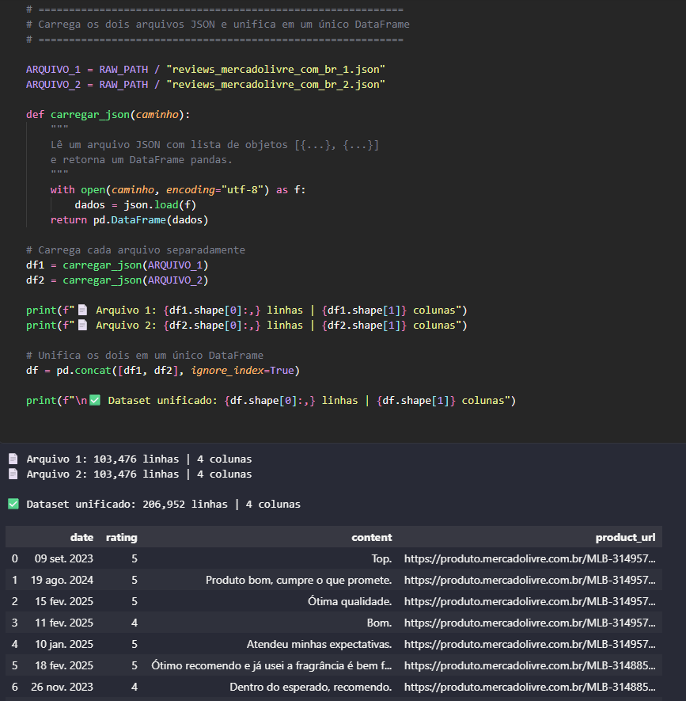
</p>

*Os dados chegaram em dois arquivos JSON com as mesmas 4 colunas (`date`, `rating`, `content`, `product_url`), que foram unificados em um único DataFrame.*

> 💡 **Decisão de projeto:** nenhuma transformação antes de entender a base. O notebook 01 só mede a qualidade dos dados e grava o resultado em [`01_relatorio_diagnostico.txt`](data/processed/01_relatorio_diagnostico.txt).

O que o diagnóstico encontrou:

| Verificação | Resultado |
|---|---|
| Registros (2 arquivos × 103.476) | 206.952 |
| Duplicatas exatas, inclusive entre os dois arquivos | 0 |
| Nulos em qualquer coluna | 0 |
| Notas fora da faixa 1–5 | 0 |
| Datas | texto em português (`"09 set. 2023"`), todas conversíveis |
| Avaliações com texto vazio | 4.167 |
| Avaliações com menos de 3 palavras | 58.712 |
| Média de palavras por avaliação | 9,4 |

O principal problema não era sujeira, era **pouco texto**: mais de um quarto das avaliações tem uma ou duas palavras ("Top.", "Amei."). Isso orientou as decisões das etapas seguintes.

---

## 🧹 Etapa 2 — Limpeza e padronização

<p align="center">
  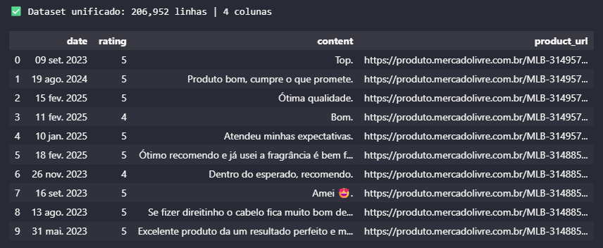
</p>

<p align="center">
  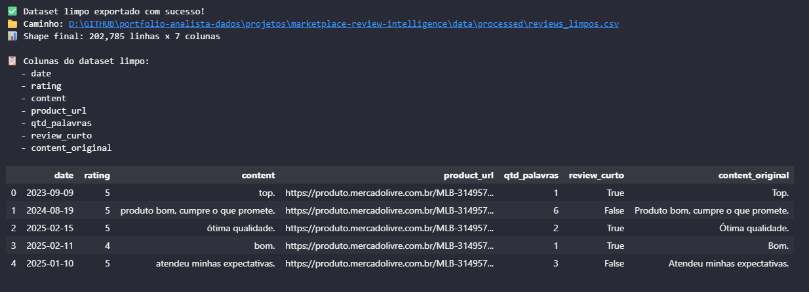
</p>

Decisões aplicadas no notebook 02:

| Decisão | Por quê |
|---|---|
| **Remover** as 4.167 avaliações com texto vazio | Sem texto não há o que analisar no sentimento |
| **Manter** as avaliações curtas, com a flag `review_curto` (54.545, ou 26,9%) | São um quarto da base. Removê-las distorceria a distribuição de notas; com a flag, podem ser filtradas no Power BI |
| **Converter** as datas de `"09 set. 2023"` para `datetime` | Necessário para a dimensão de data e a análise temporal |
| **Limpar o texto:** remover emojis, padronizar em minúsculas e tirar caracteres especiais, mantendo acentos e pontuação básica | Prepara o texto para a tokenização |
| **Preservar o texto original** em `content_original` | Permite conferir qualquer transformação depois |
| **Recalcular** `qtd_palavras` após a limpeza | A contagem anterior incluía emojis |

**Resultado:** 206.952 → **202.785 avaliações**, sem nenhuma data inválida.

---
<p align="center">
  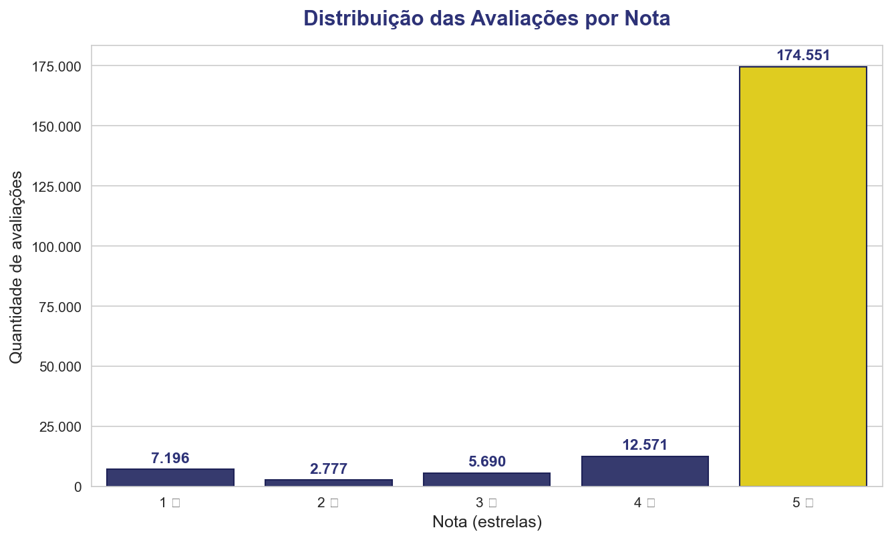
</p>

*Distribuição das notas após a limpeza: 86,1% das avaliações são 5 estrelas. Com uma base tão concentrada no positivo, o cuidado foi não esconder os sinais de insatisfação que estão na cauda.*

---

## 🔗 Etapa 3 — Atributos extraídos da URL

A base não trazia nome nem categoria do produto, só a URL. O notebook 03 extrai essas informações com expressões regulares, cobrindo os dois formatos de URL do Mercado Livre:

| Atributo | Como foi obtido | Cobertura |
|---|---|---|
| `produto_id` | código `MLB` da URL | 202.783 de 202.785 (2 URLs fora do padrão) |
| `nome_produto` | trecho descritivo da URL (slug) convertido em texto legível | 17.972 produtos |
| `categoria` | palavras-chave no slug, testadas da mais específica para a mais genérica | 20 categorias |

> 💡 **Decisão de projeto:** a ordem das regras importa. "Escova Progressiva" é testada antes de "Kit Capilar" para que um kit de progressiva não caia na categoria errada. O dicionário passou por uma segunda versão depois de investigar as palavras mais frequentes em "Outros Cosméticos", que hoje concentra 5,6% das avaliações.

---

## 💬 Etapa 4 — Análise de sentimento

<p align="center">
  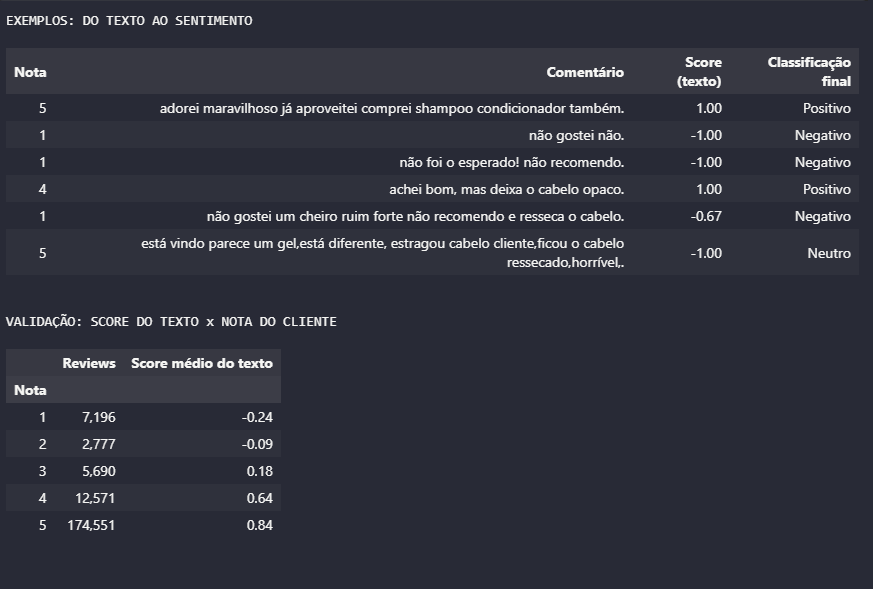
</p>

O sentimento foi calculado em duas partes: um **score** obtido só do texto e uma **classificação** que combina esse score com a nota.

### 4.1 Score de sentimento (só o texto)

1. **Tokenização** com NLTK, após remover acentos ("não" → "nao").
2. **Stopwords** em português mais termos do domínio ("ml", "kit", "entrega"…). Os negadores ("nao", "nunca", "nem"…) foram **retirados da lista de stopwords**, senão toda negação desapareceria do texto.
3. **Léxico próprio** com 70 palavras positivas e 51 negativas, com peso ±1 ou ±2 ("excelente" = +2, "ruim" = −1).
4. **Negação:** um negador inverte o peso da próxima palavra do léxico que aparecer em até 2 posições ("não gostei" = negativo).
5. **Score** = soma dos pesos ÷ soma dos pesos absolutos, resultando em um valor entre **−1 e +1**.

> 💡 **Calibração para o domínio:** a primeira versão do léxico errava em palavras ambíguas em cosméticos. "Oleoso" descreve o cabelo, não o produto; "pesado" pode ser elogio para um creme. Essas palavras foram removidas e termos do domínio, como "hidrata", "macio" e "cheiroso", foram incluídos.

**Validação do score:** mesmo calculado apenas com o texto, ele acompanha a nota dada pelo cliente.

| Nota | Score médio do texto |
|---|---|
| 1 ★ | −0,24 |
| 2 ★ | −0,09 |
| 3 ★ | 0,18 |
| 4 ★ | 0,64 |
| 5 ★ | 0,84 |

### 4.2 Classificação híbrida (texto + nota)

Avaliações muito curtas e palavras fora do léxico deixam o score igual a zero em muitos casos. Por isso a classificação final usa **a nota como âncora** e o texto para desempatar:

| Situação | Classificação |
|---|---|
| Nenhuma palavra do léxico no texto (score = 0) | Segue a nota: 4–5 Positivo · 3 Neutro · 1–2 Negativo |
| Nota 4–5 | Positivo, exceto se o texto for muito negativo (score < −0,3), aí vira Neutro |
| Nota 1–2 | Negativo, exceto se o texto for muito positivo (score > 0,3), aí vira Neutro |
| Nota 3 | Decide o texto: > 0,15 Positivo · < −0,15 Negativo · entre os dois, Neutro |

**Resultado:** 92,3% Positivo · 3,0% Neutro · 4,6% Negativo.

> 💡 **Por que híbrida?** A nota diz *quanto* o cliente gostou; o texto diz *o quê*. O texto tem peso decisivo nas avaliações de nota 3, que são ambíguas por natureza, e serve para sinalizar contradições, como nota alta com comentário crítico.

---

## 🗄 Etapa 5 — Modelagem dimensional (Star Schema)

<p align="center">
  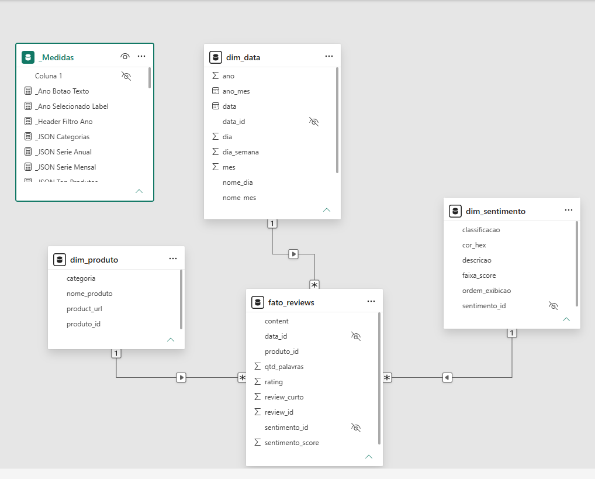
</p>

As tabelas são geradas em Python (notebook 05) e importadas no Power BI. Antes da exportação, o notebook confere a **integridade referencial**: toda chave da fato existe na dimensão correspondente (0 órfãos).

| Tabela | Tipo | Linhas | Conteúdo |
|---|---|---:|---|
| `fato_reviews` | Fato | 202.785 | chaves, `rating`, `sentimento_score`, `qtd_palavras`, `review_curto`, `content` |
| `dim_produto` | Dimensão | 17.972 | `nome_produto`, `categoria`, `product_url` |
| `dim_data` | Dimensão | 2.119 | dia, mês, ano, trimestre, semestre, dia da semana |
| `dim_sentimento` | Dimensão | 3 | classificação, descrição, ordem de exibição, cor |

> 💡 **Decisão de modelagem:** o sentimento ficou em uma dimensão própria, com descrição e cor. Assim a regra de exibição vive no modelo e não espalhada pelas medidas.

---

## 🧮 Etapa 6 — Medidas DAX em destaque

KPIs, gráficos e até as coordenadas dos SVGs são calculados em DAX.

### Proxy de NPS

O NPS original vem de uma pergunta de 0 a 10 ("você recomendaria?"). Aqui ele foi **adaptado para a escala de estrelas**: nota 5 conta como promotor e notas 1–2 como detratores. É um indicador aproximado, útil para comparar categorias e períodos dentro do projeto, mas não equivale a um NPS de pesquisa.

```dax
NPS Aproximado =
VAR Promotores =
    CALCULATE( COUNTROWS( fato_reviews ), fato_reviews[rating] = 5 )
VAR Detratores =
    CALCULATE( COUNTROWS( fato_reviews ), fato_reviews[rating] <= 2 )
VAR Total = [Total Reviews]
RETURN
    DIVIDE( Promotores - Detratores, Total, 0 ) * 100
```

> **Resultado: ≈ 81** (174.551 promotores e 9.973 detratores em 202.785 avaliações).

### Score Médio de Sentimento

```dax
Score Médio Sentimento =
AVERAGE( fato_reviews[sentimento_score] )
```

> **Resultado: ≈ 0,76** em uma escala de −1 a +1.

### % Reviews 5 Estrelas

```dax
% Reviews 5 Estrelas =
DIVIDE( [Reviews 5 Estrelas], [Total Reviews], 0 )
```

> **Resultado: ≈ 86,1%** das avaliações.

---

## 📊 Etapa 7 — O dashboard

Três páginas navegáveis, cabeçalho único com abas e filtro de ano, paleta inspirada no Mercado Livre (azul `#2D3277` e amarelo `#FFE600`) e tooltips nos gráficos.

### Página 1 — Visão Geral

<p align="center">
  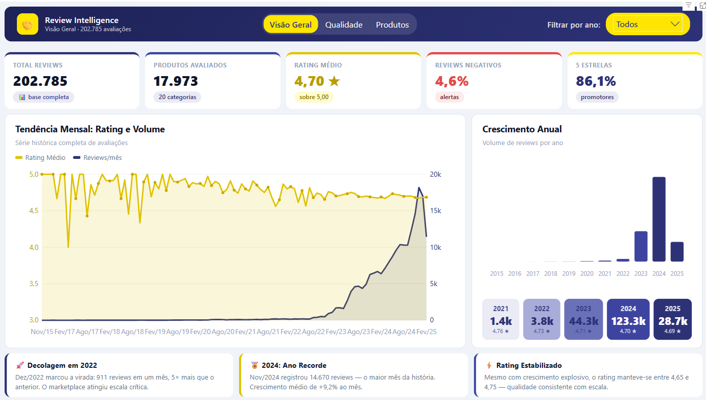
</p>

*KPIs de topo, evolução mensal de volume e nota, crescimento anual e cards de insight.*

### Página 2 — Qualidade & Sentimento

<p align="center">
  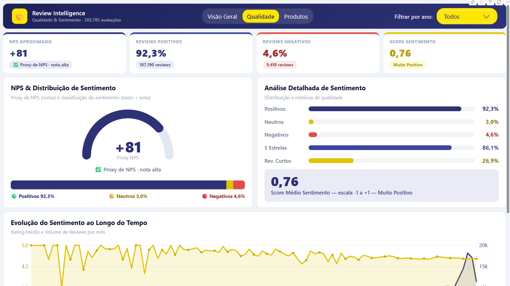
</p>

*Proxy de NPS, distribuição do sentimento, métricas de qualidade e evolução do sentimento no tempo. As faixas mantêm cores semânticas (verde, amarelo e vermelho).*

### Página 3 — Produtos & Categorias

<p align="center">
  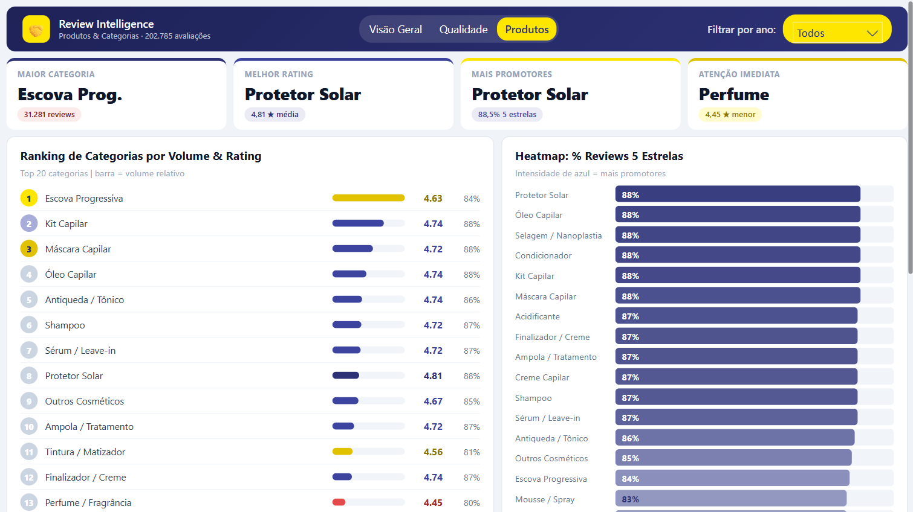
</p>

*Ranking das 20 categorias por volume e nota, heatmap de % de 5 estrelas e top 10 produtos.*

---

## 🐞 Desafios técnicos e como resolvi

Antes de publicar, conferi cada KPI do dashboard contra os números do notebook. Essa validação revelou dois erros que não apareciam olhando só o visual.

| # | O que aparecia | Causa | Solução |
|---|---|---|---|
| 1 | **"Não gostei" era classificado como positivo** | A lista de stopwords do NLTK inclui "não", então a negação era apagada antes do cálculo | Retirei os negadores da lista de stopwords e passei a remover acentos *antes* do filtro ("não" → "nao") |
| 2 | **Score de sentimento 50.407** em uma escala de −1 a +1 | O CSV usa ponto decimal (`1.0`). O Power BI em português leu o ponto como separador de milhar (`1.0` → 10), e a coluna foi importada como número inteiro | No Power Query, alterei o tipo da coluna **usando a localidade Inglês (EUA)**. O score passou a 0,76, igual ao notebook |
| 3 | **Todos os percentuais terminavam em ",1"** (negativos em 5,1% em vez de 4,6%) | Na medida HTML, `FORMAT(x; "0.1")` não significa "uma casa decimal": o `1` é impresso como caractere fixo e o número é arredondado para inteiro | Troquei o formato para `"0.0"` e passei a buscar as contagens nas medidas, em vez de reconstruí-las a partir do percentual arredondado |

<p align="center">
  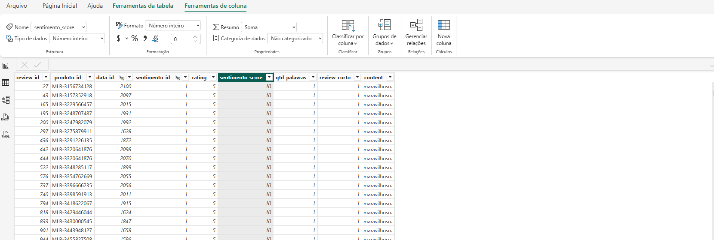
</p>

*Antes da correção: a coluna `sentimento_score` importada como número inteiro, com o valor 10 onde o notebook calculou 1,0.*

> 💡 **Aprendizado:** conferir os números do dashboard contra a fonte (aqui, o notebook; no projeto [RFM](../rfm-simplificado), o SQL) virou uma etapa fixa do meu processo antes de qualquer publicação.

---

## 💡 Principais insights

<p align="center">
  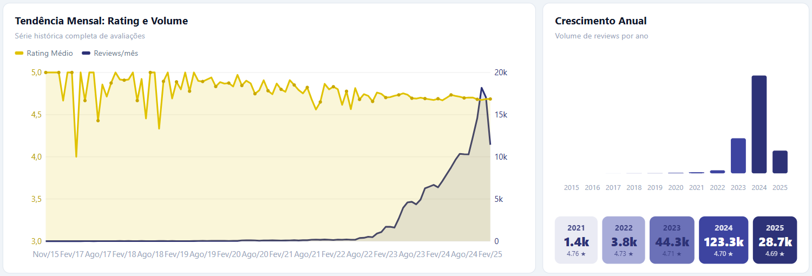
</p>

**1. O volume explodiu a partir de 2023.** Foram 1,4 mil avaliações em 2021, 3,8 mil em 2022, 44,3 mil em 2023 e **123,3 mil em 2024**. Novembro de 2024 foi o maior mês da série, com 14.670 avaliações.

**2. A satisfação acompanhou o crescimento.** A nota média anual ficou entre 4,69 e 4,76 de 2021 a 2025. Crescer quase 90 vezes sem perder qualidade percebida é o principal sinal positivo da base.

**3. Protetor Solar: melhor nota, volume intermediário.** É a categoria mais bem avaliada (4,81 e 88,5% de 5 estrelas), mas está só em 8º lugar em volume entre as 20 (11.561 avaliações). Há espaço para crescer em uma categoria que o cliente já aprova.

**4. A maior categoria está abaixo da média.** Escova Progressiva concentra 15% das avaliações (31.281) e tem nota 4,63, abaixo da média geral de 4,70. Por ser a maior, é onde uma melhora de qualidade teria mais impacto.

**5. Pontos de atenção.** Perfume/Fragrância (4,45; 80% de 5 estrelas) e Tintura/Matizador (4,56; 81%) têm as menores notas. Nas avaliações de 1 estrela, as palavras mais frequentes incluem "veio", "cheiro" e "parece", uma pista de reclamações sobre o produto recebido, que merece investigação.

**6. A negatividade cresceu com a escala.** A proporção de avaliações negativas subiu de 2,5% em 2021 para 4,6% em 2024. Vale monitorar, lembrando que 2021 tem poucas avaliações para servir de base.

---

## ⚠️ Limitações

- **Viés de seleção:** quem escreve avaliação tende a estar satisfeito ou muito insatisfeito. Os 86% de 5 estrelas descrevem quem avaliou, não todos os compradores.
- **Sentimento ancorado na nota:** nas avaliações de nota 1–2 e 4–5, a classificação segue a nota na maioria dos casos. O texto decide de fato nas avaliações de nota 3 (5.690) e nos conflitos fortes.
- **Léxico com cobertura limitada:** muitas reclamações não usam palavras do léxico ("veio diferente", "não é original"). Por isso o score médio das avaliações de 1 estrela é só −0,24.
- **Categorias inferidas:** a categoria vem de palavras-chave na URL, não de um cadastro oficial. "Outros Cosméticos" reúne 5,6% das avaliações.
- **Período parcial:** 2025 vai só até 19 de fevereiro, e os anos de 2015 a 2021 têm poucas avaliações, o que deixa a nota mensal desse período muito oscilante.
- **Calendário:** a `dim_data` contém apenas as datas com avaliação, não um calendário contínuo.

---

## 🚀 Próximos passos

- **Medir a acurácia do sentimento:** classificar manualmente uma amostra de ~300 avaliações e comparar com o resultado do modelo.
- **Comparar com um modelo pré-treinado em português** (por exemplo, um BERT treinado em PT-BR) e ver onde o léxico erra.
- **Revisar o léxico:** "cheiro" e "perfume" têm peso positivo, mas "cheiro" está entre as palavras mais frequentes nas avaliações de 1 estrela. Também vale incluir expressões de reclamação sobre entrega e autenticidade.
- **Calendário contínuo** na `dim_data`, para usar funções de inteligência de tempo do DAX sem lacunas.
- **Análise de tópicos** nas avaliações negativas, para separar problemas de produto, entrega e autenticidade.

---

## 🔄 Como reproduzir

```bash
# 1. Clone o repositório e entre na pasta do projeto
git clone https://github.com/edimilsonbraz/portfolio-analista-dados.git
cd portfolio-analista-dados/projetos/marketplace-review-intelligence

# 2. Instale as dependências
pip install -r requirements.txt

# 3. Baixe os dois arquivos JSON do dataset (link na seção "Sobre o projeto")
#    e salve em data/raw/:
#      reviews_mercadolivre_com_br_1.json
#      reviews_mercadolivre_com_br_2.json

# 4. Execute os notebooks na ordem
#    notebooks/01_diagnostico.ipynb
#    notebooks/02_limpeza.ipynb
#    notebooks/03_features_url.ipynb
#    notebooks/04_nlp_sentimento.ipynb
#    notebooks/05_modelagem_exportacao.ipynb
#
#    Os 4 CSVs finais ficam em data/output/ e são a fonte do Power BI.
```

O dashboard pode ser acessado online pelo link no topo desta página.

> ⚠️ **Importante ao importar os CSVs no Power BI em português:** altere o tipo da coluna `sentimento_score` usando a localidade **Inglês (Estados Unidos)**. Sem isso, o ponto decimal é lido como separador de milhar (veja o desafio nº 2).

### Estrutura do projeto

```
📦 marketplace-review-intelligence/
├── 📂 notebooks/          # 01 a 05, executados em ordem
├── 📂 data/
│   ├── raw/               # JSONs originais (não versionados)
│   ├── processed/         # relatório de diagnóstico e CSVs intermediários
│   └── output/            # 1 fato + 3 dimensões para o Power BI (não versionados)
├── 📂 assets/             # imagens deste README
├── requirements.txt
└── README.md
```

> ⚠️ **Nota sobre os dados:** dados públicos de avaliações do Mercado Livre, usados exclusivamente para fins educacionais e de portfólio. A base não contém nomes ou dados pessoais dos avaliadores.

---

## 👤 Autor

**Edimilson de Sousa** — Analista de Dados

[](https://linkedin.com/in/edimilsonbraz)
[](https://github.com/edimilsonbraz)
[](mailto:edimilson.gt8@gmail.com)