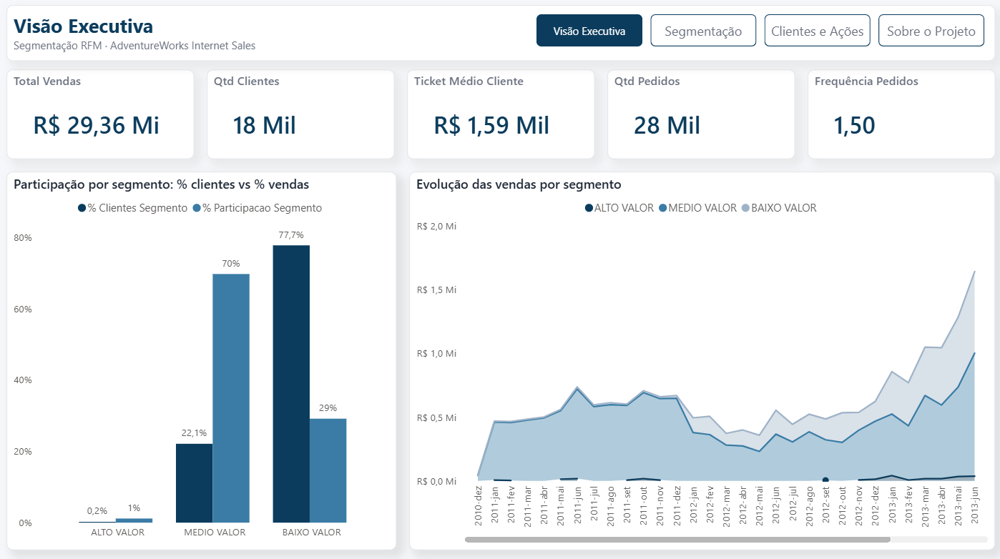
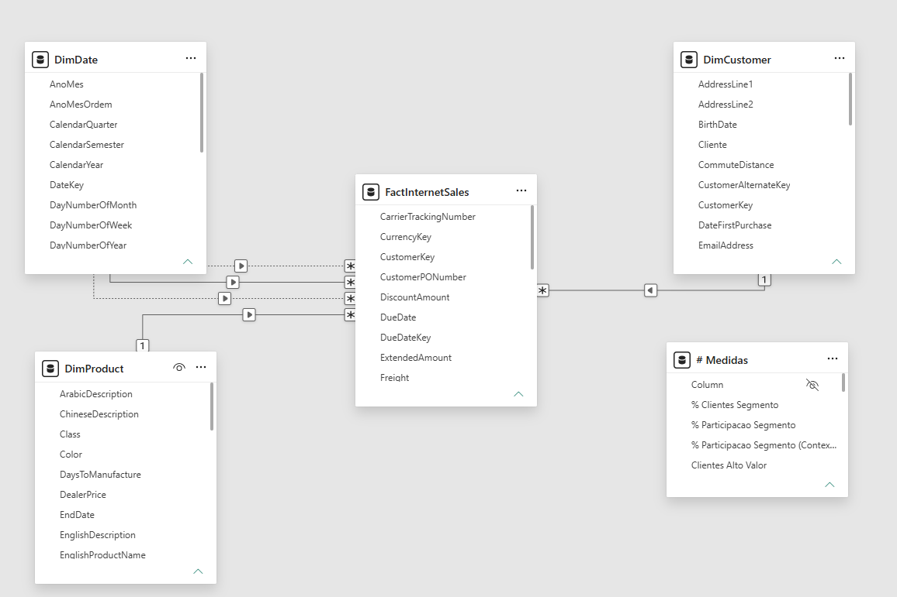
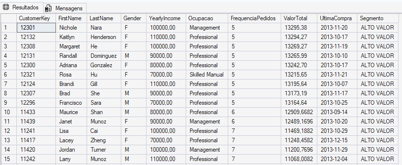
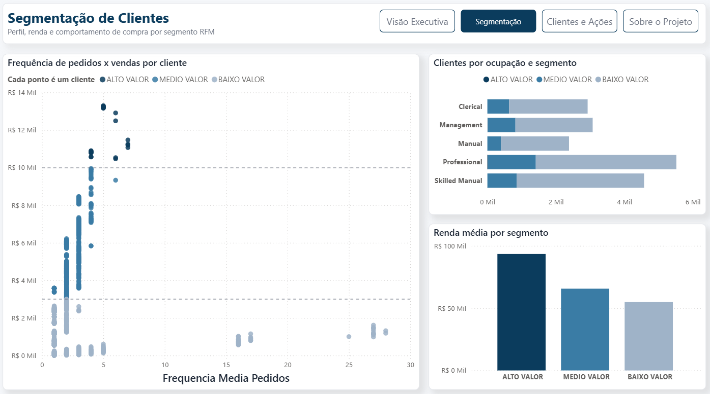
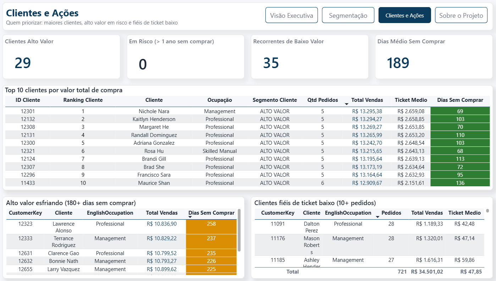
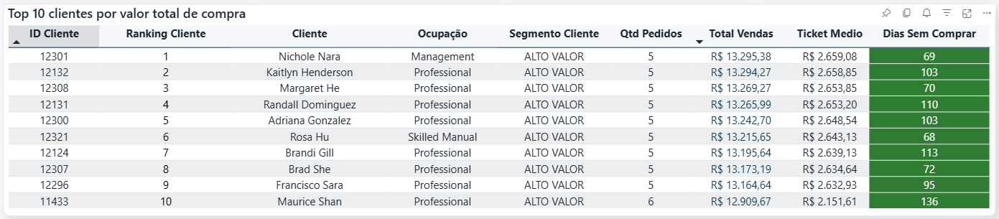
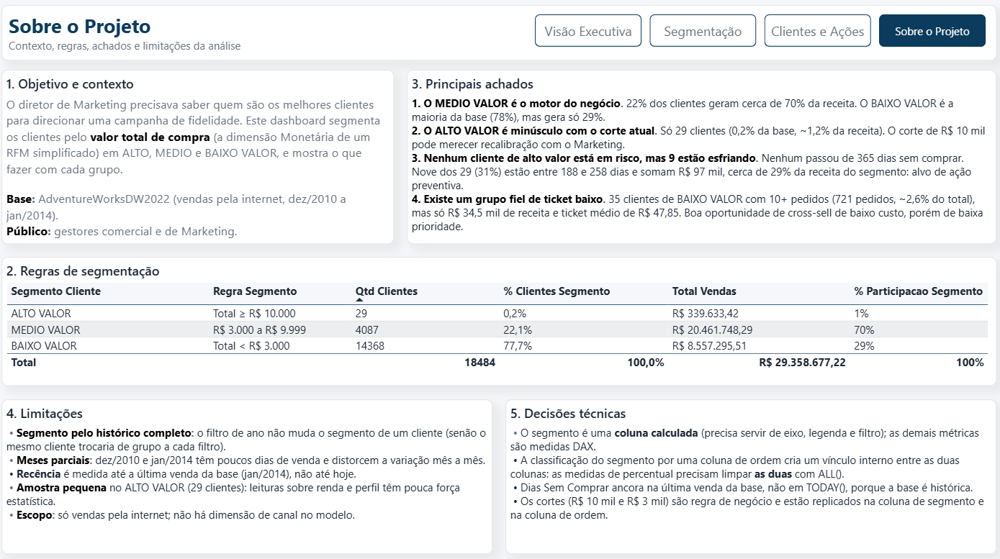

# RFM Simplificado — Segmentação de Clientes por Valor de Compra

> Segmentação de **18.484 clientes** e **R$ 29,36 milhões** em vendas online da AdventureWorks em ALTO, MÉDIO e BAIXO VALOR, para direcionar a campanha de fidelidade do Marketing.

### 🚀 Dashboard do projeto => <a href="https://app.powerbi.com/view?r=eyJrIjoiYzE4ZWVlZTMtYjA1Mi00ZTVmLTk5NGMtMDA3YWQ3OGI2NDNiIiwidCI6ImIyYjI2MzY2LWRhNmEtNGNkOS1hMzI4LTNmNWI3NzljZGI4MiJ9" target="_blank">aqui</a>


> ****
>
> **Print 1:** Visão Executiva do dashboard RFM Simplificado


---

## 📋 Índice

- [Problema de Negócio](#-problema-de-negócio)
- [Objetivo da Análise](#-objetivo-da-análise)
- [Ferramentas e Tecnologias](#️-ferramentas-e-tecnologias)
- [Estrutura do Banco de Dados](#️-estrutura-do-banco-de-dados)
- [Consultas SQL](#-consultas-sql)
- [Medidas DAX](#-medidas-dax)
- [Dashboard](#-dashboard)
- [Principais Insights](#-principais-insights)
- [Conclusão e Recomendação de Negócio](#-conclusão-e-recomendação-de-negócio)
- [Como Reproduzir o Projeto](#️-como-reproduzir-o-projeto)
- [Próximos Passos](#-próximos-passos)
- [Contato](#-contato)

---

## 💼 Problema de Negócio

A AdventureWorks, fabricante de bicicletas e acessórios com vendas pela internet, ia lançar uma **campanha de fidelidade** e não sabia para quem direcioná-la. A base tinha mais de 18 mil clientes, mas o Marketing não conseguia responder a uma pergunta simples:

> *"Quem são os nossos melhores clientes?"*
> — Diretor de Marketing

Sem essa resposta, o orçamento da campanha seria distribuído de forma igual entre clientes que geram receitas muito diferentes, e quem estivesse deixando de comprar só seria percebido tarde demais.

O pedido foi deliberadamente enxuto: não um RFM completo, mas um **ponto de partida pela dimensão Monetária** (valor total comprado), com espaço para as análises que surgissem a partir dela.

---

## 🎯 Objetivo da Análise

1. **Segmentar** cada cliente pelo valor total comprado em três grupos:

| Segmento | Regra (valor total comprado pelo cliente) |
|---|---|
| **ALTO VALOR** | ≥ R$ 10.000 |
| **MÉDIO VALOR** | R$ 3.000 a R$ 9.999 |
| **BAIXO VALOR** | < R$ 3.000 |

2. **Medir o peso de cada segmento** na base de clientes e na receita.
3. **Identificar quem priorizar**: os maiores clientes, os de alto valor que começam a esfriar e outros grupos acionáveis.
4. **Entregar um dashboard** de segmentação com scatter plot, ranking de clientes e distribuição por segmento.

**Público:** gestor comercial e gestor de Marketing.

---

## 🛠️ Ferramentas e Tecnologias

| Categoria | Ferramenta | Uso no projeto |
|---|---|---|
| Banco de dados | **SQL Server 2022** | Hospedagem da AdventureWorksDW2022 |
| Consulta | **T-SQL** (CTE, `CASE`, funções de janela) | Segmentação, análises de apoio e validação |
| Modelagem | **Power BI** (modo Import) | Modelo estrela com relacionamentos 1:* |
| Cálculo | **DAX** | Segmento, percentuais, ranking, tempo e recência |
| Visualização | **Power BI Desktop** | Dashboard de 4 páginas com formatação condicional |
| Documentação | **Markdown / GitHub** | Este README |

---

## 🗄️ Estrutura do Banco de Dados

Base: **AdventureWorksDW2022**, um data warehouse de exemplo da Microsoft em modelo dimensional. As vendas vão de **dezembro de 2010 a janeiro de 2014**.

| Tabela | Tipo | Grão | Colunas usadas |
|---|---|---|---|
| `FactInternetSales` | Fato | Uma linha por item de pedido | `CustomerKey`, `ProductKey`, `OrderDateKey`, `SalesOrderNumber`, `SalesAmount`, `OrderDate` |
| `DimCustomer` | Dimensão | Uma linha por cliente | `CustomerKey`, `FirstName`, `LastName`, `Gender`, `YearlyIncome`, `EnglishOccupation` |
| `DimDate` | Dimensão | Uma linha por dia | `DateKey`, `FullDateAlternateKey`, `CalendarYear`, `MonthNumberOfYear`, `EnglishMonthName` |
| `DimProduct` | Dimensão | Uma linha por produto | `ProductKey`, `EnglishProductName` |

### Modelo no Power BI

| Relacionamento | Cardinalidade | Filtro | Situação |
|---|---|---|---|
| `DimCustomer[CustomerKey]` → `FactInternetSales[CustomerKey]` | 1:* | Único | Ativo |
| `DimDate[DateKey]` → `FactInternetSales[OrderDateKey]` | 1:* | Único | Ativo |
| `DimDate[DateKey]` → `FactInternetSales[ShipDateKey]` | 1:* | Único | Inativo |
| `DimDate[DateKey]` → `FactInternetSales[DueDateKey]` | 1:* | Único | Inativo |
| `DimProduct[ProductKey]` → `FactInternetSales[ProductKey]` | 1:* | Único | Ativo |

> ****
>
> **Print 2:** Modelo estrela do projeto no Power BI


**Decisões de modelagem:**
- **Tabelas separadas, não a consulta pronta.** Importar a consulta agregada perderia o grão de item de pedido e bloquearia análises por tempo e produto.
- **`DimDate` marcada como Tabela de Datas**, requisito das funções de inteligência de tempo.
- **Colunas `AnoMes` e `AnoMesOrdem`** na `DimDate`, para o eixo de tempo ficar em ordem cronológica.

---

## 🗃️ Consultas SQL

### Consulta principal — segmentação por cliente

```sql
/* Uma linha por cliente, com métricas e segmento */
WITH ResumoCliente AS (
    SELECT
        c.CustomerKey,
        c.FirstName,
        c.LastName,
        c.Gender,
        c.YearlyIncome,
        c.EnglishOccupation                  AS Ocupacao,
        COUNT(DISTINCT f.SalesOrderNumber)   AS FrequenciaPedidos,  -- pedidos distintos, não itens
        SUM(f.SalesAmount)                   AS ValorTotal,
        MAX(d.FullDateAlternateKey)          AS UltimaCompra
    FROM FactInternetSales AS f
    INNER JOIN DimCustomer AS c ON f.CustomerKey  = c.CustomerKey
    INNER JOIN DimDate     AS d ON f.OrderDateKey = d.DateKey
    GROUP BY c.CustomerKey, c.FirstName, c.LastName,
             c.Gender, c.YearlyIncome, c.EnglishOccupation
)
SELECT
    *,
    CASE
        WHEN ValorTotal >= 10000 THEN 'ALTO VALOR'
        WHEN ValorTotal >= 3000  THEN 'MEDIO VALOR'
        ELSE 'BAIXO VALOR'
    END AS Segmento
FROM ResumoCliente
ORDER BY ValorTotal DESC;
```

- A **CTE** evita repetir o `SUM` dentro do `CASE`: o SQL Server não aceita usar o apelido `ValorTotal` na mesma linha em que é criado.
- O **`COUNT(DISTINCT SalesOrderNumber)`** impede que os vários itens de um pedido inflem a frequência.
- A **ordem do `CASE`** importa: o teste de 10.000 vem antes do de 3.000.

### Distribuição por segmento

```sql
WITH Segmentos AS (
    SELECT
        CustomerKey,
        CASE
            WHEN SUM(SalesAmount) >= 10000 THEN 'ALTO VALOR'
            WHEN SUM(SalesAmount) >= 3000  THEN 'MEDIO VALOR'
            ELSE 'BAIXO VALOR'
        END AS Segmento,
        SUM(SalesAmount) AS ValorTotal
    FROM FactInternetSales
    GROUP BY CustomerKey
)
SELECT
    Segmento,
    COUNT(*)                                                  AS QtdClientes,
    CAST(100.0 * COUNT(*) / SUM(COUNT(*)) OVER () AS DECIMAL(5,2))            AS PctClientes,
    SUM(ValorTotal)                                           AS Receita,
    CAST(100.0 * SUM(ValorTotal) / SUM(SUM(ValorTotal)) OVER () AS DECIMAL(5,2)) AS PctReceita
FROM Segmentos
GROUP BY Segmento
ORDER BY Receita DESC;
```

### Validação das medidas DAX

```sql
-- Deve bater com a medida [Total Vendas] sem filtros: R$ 29.358.677,22
SELECT SUM(SalesAmount) AS TotalVendas
FROM FactInternetSales;
```

> ****
>
> **Print 3:** Resultado da consulta de segmentação no SQL Server

---

## 🧮 Medidas DAX

As medidas ficam numa tabela vazia chamada `# Medidas`. As duas colunas calculadas ficam em `DimCustomer`.


### Resumo

| # | Nome | Tipo | Visual principal |
|---|---|---|---|
| 1 | Segmento Cliente | Coluna calculada | Eixos, legendas e filtros de todas as páginas |
| 2 | Total Vendas | Medida | Cartão, scatter, tabelas |
| 3 | Qtd Clientes | Medida | Cartão, perfil por ocupação |
| 4 | Qtd Pedidos | Medida | Cartão, ranking |
| 5 | Ticket Medio por Cliente | Medida | Cartão |
| 6 | Frequencia Media Pedidos | Medida | Cartão, eixo X do scatter |
| 7 | % Clientes Segmento | Medida | Distribuição por segmento |
| 8 | % Participacao Segmento | Medida | Distribuição por segmento |
| 9 | Ranking Cliente | Medida | Tabela Top 10 |
| 10 | Dias Sem Comprar | Medida | Ranking e listas de ação |
| 11 | Clientes Alto Valor em Risco | Medida | Cartão "Em Risco" |
| 12 | Clientes Recorrentes Baixo Valor | Medida | Cartão "Recorrentes de Baixo Valor" |


---

### 1. Segmento Cliente *(coluna calculada em `DimCustomer`)*

```dax
Segmento Cliente =
VAR ValorTotalCliente =
    CALCULATE ( SUM ( FactInternetSales[SalesAmount] ) )
RETURN
    SWITCH (
        TRUE (),
        ValorTotalCliente >= 10000, "ALTO VALOR",
        ValorTotalCliente >= 3000,  "MEDIO VALOR",
        ValorTotalCliente < 3000,   "BAIXO VALOR",
        "SEM COMPRAS"
    )
```

**O que calcula:** classifica cada cliente pelo valor total que comprou. O `CALCULATE` faz a transição de contexto: transforma o cliente da linha em um filtro sobre a tabela de vendas.
<br>
**Onde é usada:** eixo do gráfico de distribuição, legenda do gráfico de áreas e do scatter, perfil por ocupação, renda por segmento e filtros das listas de ação.


---

### 2. Total Vendas

```dax
Total Vendas = SUM ( FactInternetSales[SalesAmount] )
```

**O que calcula:** a soma do valor vendido. É a base de quase todas as outras medidas.
<br>
**Onde é usada:** cartão "Total Vendas" (página 1), eixo Y do scatter (página 2), gráfico de áreas e todas as tabelas de clientes.

---

### 3. Qtd Clientes

```dax
Qtd Clientes = DISTINCTCOUNT ( FactInternetSales[CustomerKey] )
```

**O que calcula:** quantos clientes distintos compraram no contexto atual.
<br>
**Onde é usada:** cartão "Qtd Clientes" (página 1), gráfico de perfil por ocupação (página 2) e tabela de regras (página 4).

---

### 4. Qtd Pedidos

```dax
Qtd Pedidos = DISTINCTCOUNT ( FactInternetSales[SalesOrderNumber] )
```

**O que calcula:** o número de pedidos distintos. Cada pedido tem várias linhas na fato (uma por item), por isso a contagem distinta.
<br>
**Onde é usada:** cartão "Qtd Pedidos" (página 1) e coluna da tabela de ranking (página 3).

---

### 5. Ticket Medio por Cliente

```dax
Ticket Medio por Cliente =
DIVIDE ( [Total Vendas], DISTINCTCOUNT ( FactInternetSales[CustomerKey] ) )
```

**O que calcula:** quanto cada cliente gasta, em média. O `DIVIDE` devolve vazio em vez de erro quando o divisor é zero.
<br>
**Onde é usada:** cartão "Ticket Médio Cliente" (página 1), valor de **R$ 1,59 mil**.

---

### 6. Frequencia Media Pedidos

```dax
Frequencia Media Pedidos =
DIVIDE (
    DISTINCTCOUNT ( FactInternetSales[SalesOrderNumber] ),
    DISTINCTCOUNT ( FactInternetSales[CustomerKey] )
)
```

**O que calcula:** quantos pedidos cada cliente faz, em média.
<br>
**Onde é usada:** cartão "Frequência Pedidos" (página 1, valor **1,50**) e eixo X do scatter (página 2), onde cada ponto é um cliente.

---

### 7. % Clientes Segmento

```dax
% Clientes Segmento =
DIVIDE (
    [Qtd Clientes],
    CALCULATE (
        [Qtd Clientes],
        ALL ( DimCustomer[Segmento Cliente], DimCustomer[Ordem Segmento] )
    )
)
```

**O que calcula:** a parcela da base de clientes que pertence a cada segmento.
<br>
**Onde é usada:** gráfico "Distribuição por segmento" (página 1) e tabela de regras (página 4).

---

### 8. % Participacao Segmento

```dax
% Participacao Segmento =
DIVIDE (
    [Total Vendas],
    CALCULATE (
        [Total Vendas],
        ALL ( DimCustomer[Segmento Cliente], DimCustomer[Ordem Segmento] )
    )
)
```

**O que calcula:** a parcela da receita total gerada por cada segmento.
<br>
**Onde é usada:** ao lado de `% Clientes Segmento` no gráfico "Distribuição por segmento". A comparação entre as duas barras é o principal achado do projeto.

---

### 9. Ranking Cliente

```dax
Ranking Cliente =
RANKX ( ALL ( DimCustomer ), [Total Vendas], , DESC )
```

**O que calcula:** a posição do cliente entre todos os clientes, do maior para o menor valor comprado.
<br>
**Onde é usada:** tabela "Top 10 clientes por valor total de compra" (página 3), com filtro Top N.

---

### 10. Dias Sem Comprar

```dax
Dias Sem Comprar =
VAR DataReferencia =
    CALCULATE ( MAX ( FactInternetSales[OrderDate] ), REMOVEFILTERS () )
VAR UltimaCompra =
    CALCULATE ( MAX ( FactInternetSales[OrderDate] ), REMOVEFILTERS ( DimDate ) )
RETURN
    IF ( NOT ISBLANK ( UltimaCompra ), DATEDIFF ( UltimaCompra, DataReferencia, DAY ) )
```

**O que calcula:** quantos dias se passaram entre a última compra do cliente e a última venda da base.
<br>
**Onde é usada:** coluna com semáforo (verde < 180, âmbar 180–364, vermelho ≥ 365) no ranking e na lista "Alto valor esfriando" (página 3).

---

### 11. Clientes Alto Valor em Risco

```dax
Clientes Alto Valor em Risco =
COUNTROWS (
    FILTER (
        DimCustomer,
        DimCustomer[Segmento Cliente] = "ALTO VALOR"
            && [Dias Sem Comprar] > 365
    )
)
```

**O que calcula:** quantos clientes de alto valor estão há mais de um ano sem comprar.
<br>
**Onde é usada:** cartão "Em Risco" (página 3), com formatação condicional em vermelho para valores acima de zero.

---

### 12. Clientes Recorrentes Baixo Valor

```dax
Clientes Recorrentes Baixo Valor =
COUNTROWS (
    FILTER (
        DimCustomer,
        DimCustomer[Segmento Cliente] = "BAIXO VALOR"
            && [Qtd Pedidos Historico] >= 10
    )
)
```

**O que calcula:** clientes de baixo valor que compraram 10 vezes ou mais: fiéis, mas de ticket pequeno.
<br>
**Onde é usada:** cartão "Recorrentes de Baixo Valor" (página 3), valor **35**.

---

### Medidas de apoio

Criadas e validadas durante o desenvolvimento, prontas para análises de tendência:

| Medida | DAX | Finalidade |
|---|---|---|
| Ticket Medio | `DIVIDE([Total Vendas], DISTINCTCOUNT(FactInternetSales[SalesOrderNumber]))` | Valor médio por pedido |
| Vendas Mes Anterior | `CALCULATE([Total Vendas], DATEADD(DimDate[FullDateAlternateKey], -1, MONTH))` | Comparação mês a mês |
| Crescimento % MoM | `DIVIDE([Total Vendas] - [Vendas Mes Anterior], [Vendas Mes Anterior])` | Variação mensal |
| Vendas YTD | `IF(NOT ISBLANK([Total Vendas]), TOTALYTD([Total Vendas], DimDate[FullDateAlternateKey]))` | Acumulado no ano |
| Ranking Produto | `RANKX(ALL(DimProduct[EnglishProductName]), [Total Vendas], , DESC)` | Ranking de produtos |

---

## 📈 Dashboard

O dashboard tem quatro páginas, que contam a história em três atos: **panorama → diagnóstico → ação**, mais uma página de documentação.

### Página 1 — Visão Executiva

O Print 1, no topo deste README, mostra esta página.

### Página 2 — Segmentação

> ****
>
> **Print 4:** Scatter de frequência × valor total por cliente


### Página 3 — Clientes e Ações

> ****
>
> **Print 5:** Ranking de clientes e listas de ação


> ****
>
> **Print 6:** Formatação condicional da tabela de ranking

<!--  -->

### Página 4 — Sobre o Projeto

> ****
>
> **Print 7:** Documentação dentro do dashboard

---

## 💡 Principais Insights

| Segmento | Clientes | % clientes | Receita | % receita |
|---|---:|---:|---:|---:|
| ALTO VALOR | 29 | 0,2% | R$ 339.633 | 1,2% |
| MÉDIO VALOR | 4.087 | 22,1% | R$ 20.461.748 | **69,7%** |
| BAIXO VALOR | 14.368 | **77,7%** | R$ 8.557.296 | 29,1% |
| **Total** | **18.484** | **100%** | **R$ 29.358.677** | **100%** |

1. **🏆 O MÉDIO VALOR é o motor do negócio.** Apenas **22% dos clientes geram cerca de 70% da receita**.
2. **📉 O BAIXO VALOR é a maioria, mas pesa pouco.** **78% dos clientes** respondem por só **29% da receita**.
3. **🔍 O ALTO VALOR é minúsculo com o corte atual.** São **29 clientes** (0,2% da base) e 1,2% da receita.
4. **✅ Nenhum cliente de alto valor está em risco, mas 9 estão esfriando.** Nenhum passou de 365 dias sem comprar; o maior intervalo é de **258 dias**. Nove dos 29 estão entre 188 e 258 dias e somam **R$ 97.412**, cerca de **29% da receita do segmento**.
5. **🔁 Existe um grupo fiel de ticket baixo.** **35 clientes** de BAIXO VALOR fizeram **721 pedidos**, mas geraram só **R$ 34.501** (ticket médio de **R$ 47,85**).
6. **🛒 O cliente típico compra pouco e raramente.** Ticket médio de **R$ 1,59 mil** por cliente e **1,5 pedido** em média.

---

## ✅ Conclusão e Recomendação de Negócio

A pergunta *"quem são os melhores clientes?"* tem uma resposta diferente da esperada: **o valor da base não está no topo, está no meio**. O segmento MÉDIO VALOR sustenta quase 70% do faturamento e deve ser o foco da campanha de fidelidade.

**Recomendações ao Marketing, por prioridade:**

1. **Fidelizar o MÉDIO VALOR (prioridade alta).** Programa de pontos ou benefícios progressivos para os 4.087 clientes que geram R$ 20,5 milhões. Uma retenção pequena aqui tem o maior impacto absoluto.
2. **Reativar preventivamente os 9 de alto valor esfriando (prioridade alta, custo baixo).** Contato personalizado antes que passem de um ano sem comprar. São R$ 97 mil em risco potencial concentrados em 9 nomes.
3. **Recalibrar o corte de ALTO VALOR (decisão de negócio).** Com R$ 10 mil, só 29 clientes entram no grupo. Avaliar um corte relativo (top 5% ou top 10%) para criar um segmento VIP com tamanho útil.
4. **Cross-sell de baixo custo para os recorrentes de ticket baixo (prioridade baixa).** Os 35 clientes fiéis aceitam ofertas por e-mail, mas o ganho potencial é pequeno (a receita atual do grupo é de R$ 34,5 mil).

**Limitações a considerar:**
- O segmento usa o histórico completo; filtrar um ano não reclassifica o cliente.
- Dezembro de 2010 e janeiro de 2014 são meses parciais e foram excluídos dos gráficos de tendência.
- A recência é medida até a última venda da base (janeiro de 2014), não até hoje.
- Com 29 clientes, leituras sobre o perfil do ALTO VALOR têm pouca força estatística.

---

## ▶️ Como Reproduzir o Projeto

### Pré-requisitos

- SQL Server 2019 ou superior e SQL Server Management Studio (SSMS)
- Power BI Desktop
- Backup do [AdventureWorksDW2022](https://learn.microsoft.com/sql/samples/adventureworks-install-configure)

### Passo a passo

1. **Clone o repositório**
   ```bash
   git clone https://github.com/edimilsonbraz/portfolio-analista-dados/tree/master/projetos.git
   cd rfm-simplificado
   ```

2. **Restaure o banco** no SSMS: botão direito em *Bancos de Dados* → *Restaurar Banco de Dados* → selecione `AdventureWorksDW2022.bak`.

3. **Rode as consultas** da pasta `sql/` e confira a validação:
   ```sql
   SELECT SUM(SalesAmount) AS TotalVendas FROM FactInternetSales;
   -- Esperado: 29358677,22
   ```

4. **Abra o dashboard** `powerbi/rfm-simplificado.pbix` no Power BI Desktop.

5. **Aponte para o seu servidor:** *Página Inicial → Transformar dados → Configurações da fonte de dados → Alterar Fonte*. Informe o servidor no formato `<SEU_SERVIDOR>,1433` (vírgula antes da porta) e o banco `AdventureWorksDW2022`. Use o modo **Import**.

6. **Atualize** os dados (*Página Inicial → Atualizar*) e confira se o cartão "Total Vendas" mostra **R$ 29,36 Mi**.

### Estrutura do repositório

```
📦 rfm-simplificado/
├── 📂 sql/
│   ├── 01_segmentacao_clientes.sql
│   ├── 02_distribuicao_segmentos.sql
│   └── 03_validacao_medidas.sql
├── 📂 dax/
│   └── medidas.dax
├── 📂 powerbi/
│   ├── rfm-simplificado.pbix
│   └── tema-adventureworks.json
├── 📂 assets/          # Prints deste README
└── README.md
```

---

## 🚀 Próximos Passos

- **RFM completo:** pontuar Recência, Frequência e valor Monetário de 1 a 5 e cruzar os três.
- **Segmentação relativa:** comparar o corte fixo com quantis (`NTILE`) e com a curva ABC (Pareto).
- **Perfil de produto por segmento:** incluir `DimProductSubcategory` e `DimProductCategory` para saber o que cada grupo compra.
- **Análise geográfica:** incluir `DimSalesTerritory` para comparar segmentos por região.
- **Parâmetros de corte:** usar um parâmetro What-If no Power BI para o Marketing testar outros limites de segmento sem editar DAX.
- **Atualização automática:** publicar no Power BI Service com atualização agendada.

---

## 📬 Contato

**Edimilson de Sousa** — Analista de Dados

[](https://linkedin.com/in/edimilsonbraz)
[](https://github.com/edimilsonbraz)
[](mailto:edimilson.gt8@gmail.com)

---

<sub>Dados: AdventureWorksDW2022, base de exemplo pública da Microsoft. Projeto desenvolvido para fins de portfólio.</sub>
